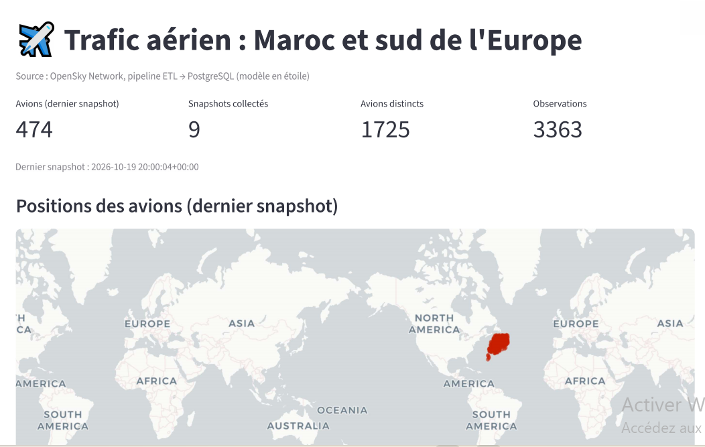
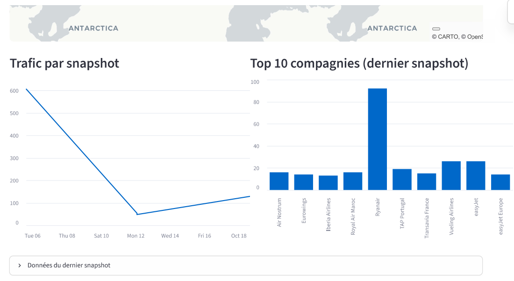
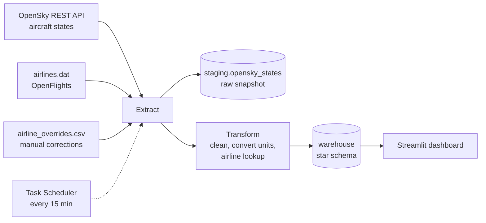
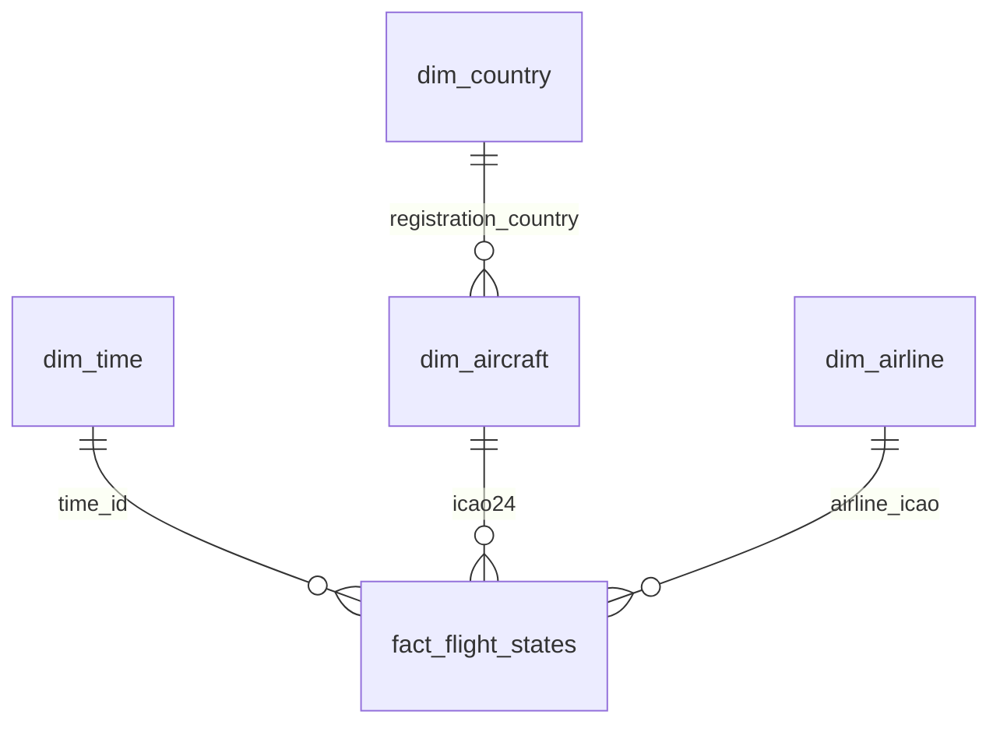

# ✈️ Flights ETL Pipeline

An end-to-end **ETL pipeline** that collects live aircraft positions from the [OpenSky Network](https://opensky-network.org/) over Morocco and southern Europe, cleans and enriches them with airline reference data, and loads them into a **PostgreSQL star schema**. A **Streamlit dashboard** sits on top of the warehouse.

The pipeline runs automatically every 15 minutes, so the warehouse accumulates a time series of air traffic (day/night patterns, busiest airlines, etc.).

## Dashboard




## Architecture



## Data model



| Table | Content |
|---|---|
| `fact_flight_states` | One row per aircraft per snapshot (position, altitude in ft, speed in km/h, on ground, ...) |
| `dim_time` | One row per snapshot (date, hour, day of week) |
| `dim_aircraft` | One row per aircraft (`icao24`) and its registration country |
| `dim_airline` | Airline code, name, IATA code, country |
| `dim_country` | Registration countries |

Raw responses are also stored in `staging.opensky_states`.

## Data sources

| Source | Used for |
|---|---|
| OpenSky Network REST API (`/states/all`, OAuth2) | Live aircraft states inside a bounding box (lat 27 to 45, lon -14 to 5) |
| [OpenFlights](https://github.com/jpatokal/openflights) `airlines.dat` | Airline names from the ICAO code |
| `data/reference/airline_overrides.csv` | Manual corrections for airlines missing from `airlines.dat` |

The data sources are subject to their own terms of use.

## Key design decisions

- **Idempotent loads**: re-running the pipeline never duplicates data (`ON CONFLICT` on natural keys, `UNIQUE (icao24, time_id)` on the fact table, staging replaced per snapshot).
- **Airline detection from the callsign**: three letters followed by a digit (`TVF73DJ` → `TVF`). Private aircraft (`FCVRB`) are not matched to an airline.
- **Reference data can be incomplete**: unknown airline codes get the name `Unknown`, and `airline_overrides.csv` fixes the most frequent ones.
- **Resilience**: network calls are retried with increasing delays (the laptop may wake up before the Wi-Fi does).
- **Observability**: logs in `logs/pipeline.log` and a run summary (extracted, rejected, loaded, duration).
- **Tested transformations**: 10 unit tests on small hand-made DataFrames.

## Project structure

```
.
├── main.py                  # orchestrates extract → transform → load
├── run_pipeline.bat         # entry point used by the scheduler
├── src/
│   ├── extract.py           # OpenSky API, CSV files, retry logic
│   ├── transform.py         # cleaning, unit conversion, airline lookup, star schema
│   ├── load.py              # PostgreSQL loading (staging + warehouse)
│   └── utils.py             # logging
├── sql/create_tables.sql    # schemas and tables
├── dashboard/app.py         # Streamlit dashboard
├── tests/test_transform.py  # unit tests
├── data/reference/          # airline_overrides.csv
├── notebooks/               # data exploration
└── docs/                    # screenshots
```

## Getting started

**Requirements**: Python 3.13 (tested), PostgreSQL, a free [OpenSky](https://opensky-network.org/) account (optional, but anonymous access has a much smaller daily credit budget).

```powershell
# 1. Install
git clone https://github.com/Farahimni/etl-flights-pipeline.git
cd etl-flights-pipeline
python -m venv venv
venv\Scripts\activate
pip install -r requirements.txt

# 2. Configure: create a database named flights_dw in PostgreSQL, then
Copy-Item .env.example .env        # and fill in your values

# 3. Download the airline reference file
mkdir data\raw
curl.exe -L -o data\raw\airlines.dat https://raw.githubusercontent.com/jpatokal/openflights/master/data/airlines.dat

# 4. Run the pipeline once
python main.py

# 5. Open the dashboard
streamlit run dashboard/app.py

# 6. Run the tests
python -m pytest -v
```

### Run it every 15 minutes (Windows)

```powershell
schtasks /Create /TN "ETL Flights Pipeline" /SC MINUTE /MO 15 /TR "C:\full\path\to\run_pipeline.bat"
```

## Limitations and next steps

- OpenSky only exposes the current state of the sky: history exists only from the moment the scheduler starts running.
- The dashboard reads from a local database and is not deployed yet.
- Next: Docker Compose (PostgreSQL + pipeline + dashboard), a `dim_airport` dimension (nearest airport per aircraft), orchestration with Airflow.

## Skills demonstrated

Python (pandas, SQLAlchemy, requests), REST API with OAuth2, data cleaning, dimensional modeling (star schema), PostgreSQL, idempotent ETL design, logging and error handling, unit testing (pytest), scheduling, Streamlit.

## Author

Farah imni(https://github.com/Farahimni)